# VoltFlow POS — System Architecture

Detailed architecture of VoltFlow POS (`pos-eet-himmel`). All diagrams are [Mermaid](https://mermaid.js.org/) and render on GitHub and in most Markdown viewers.

Contents:

1. [System context](#1-system-context)
2. [Deployment modes](#2-deployment-modes)
3. [Desktop shell (Tauri)](#3-desktop-shell-tauri)
4. [Backend](#4-backend-fastapi)
5. [Data model](#5-data-model)
6. [Frontend](#6-frontend-react-19)
7. [Key flows](#7-key-flows)
8. [Integrations](#8-integrations)
9. [Cloud and remote dashboard](#9-cloud-and-remote-dashboard)
10. [Security](#10-security)
11. [Build, packaging and CI](#11-build-packaging-and-ci)
12. [Quality gates](#12-quality-gates)

---

## 1. System context

VoltFlow is a local-first POS. The register runs entirely on one machine: a React UI talks over HTTP to a FastAPI backend on `:8000`, which owns the SQLite database and all hardware. The cloud pieces are optional.

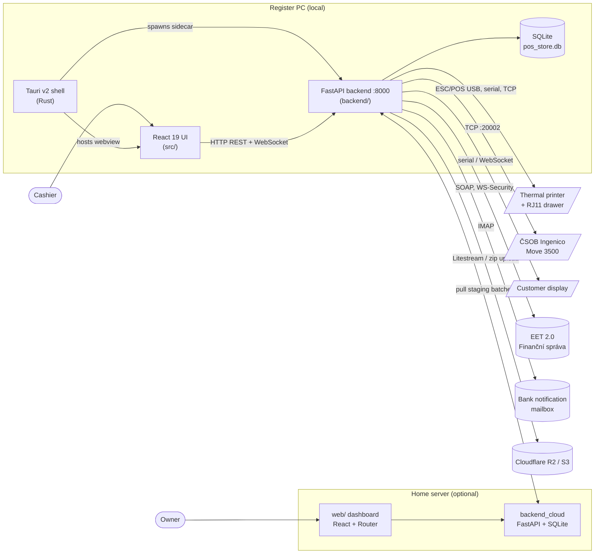

| Layer | Technology | Location |
| :-- | :-- | :-- |
| Desktop shell | Tauri v2, Rust | `src-tauri/` |
| Register UI | React 19, Vite, vanilla CSS, Vitest, Oxlint | `src/` |
| Backend | Python FastAPI, SQLAlchemy, SQLite (WAL) | `backend/` |
| Cloud API | FastAPI, SQLite, Docker | `backend_cloud/` |
| Remote dashboard | React 19, react-router | `web/` |
| Packaging | PyInstaller (backend), NSIS and MSI (Tauri) | `scripts/`, `backend/pos_backend.spec` |

---

## 2. Deployment modes

The same backend and UI run in three ways.

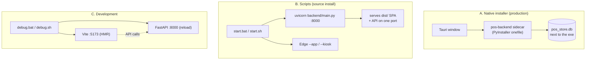

| Mode | UI served by | Backend started by | Notes |
| :-- | :-- | :-- | :-- |
| A. Native installer | Tauri webview | Tauri sidecar (`pos-backend`) | Needs no Python or Node on the terminal |
| B. Scripts | FastAPI static mount of `dist/` | `start.bat` / `start.sh` | Binds `0.0.0.0` unless frozen, so LAN clients can reach it |
| C. Development | Vite dev server | `debug.*` | Backend reload when `ENV=development` |

When frozen, the backend binds `127.0.0.1` and stores data in `POS_DATA_DIR` or next to the executable. It never stores data in PyInstaller's temporary `_MEIPASS` folder.

---

## 3. Desktop shell (Tauri)

`src-tauri/src/lib.rs` owns the process lifecycle.

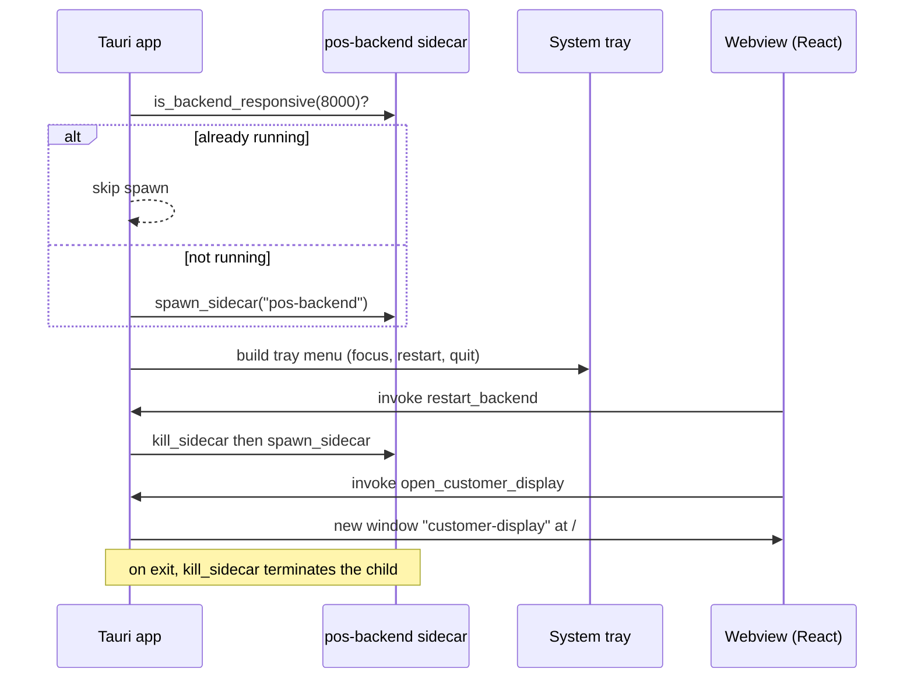

- Commands exposed to the UI: `restart_backend`, `open_customer_display`.
- `src/hooks/useTauri.js` wraps these calls and falls back to browser APIs on the web.
- Capabilities live in `src-tauri/capabilities/default.json`; window and bundle settings in `tauri.conf.json`.

---

## 4. Backend (FastAPI)

### 4.1 Layers

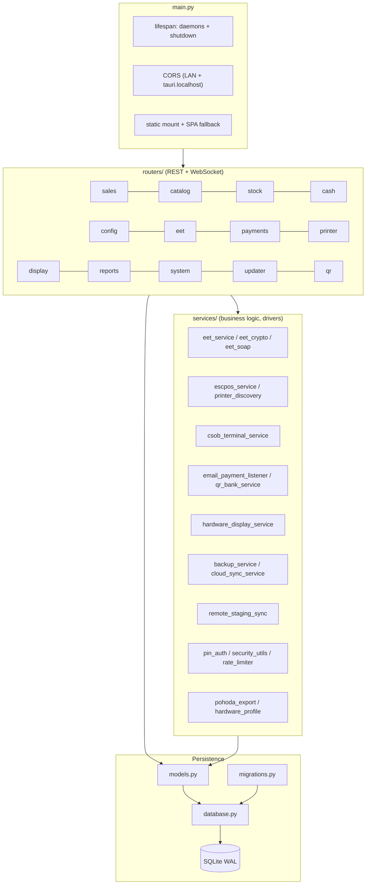

### 4.2 Routers and endpoints

All routers sit under `/api/v1/...`.

| Router | Prefix | Main endpoints |
| :-- | :-- | :-- |
| `sales.py` | `/sales` | `POST /` create sale, `GET /`, `GET /{id}`, `GET /by-receipt/{n}`, `PUT /{id}/refund-status`, `GET /next-receipt-number`, `GET /stats/daily`, `GET /stats/shift`, `GET /export/pohoda`, `GET /{id}/invoice-html`, `DELETE /{id}`, `DELETE /purge-all` |
| `catalog.py` | `/catalog` | categories (list, create, delete, reorder); presets (list, create, bulk, delete, reorder, toggle-pin, restock); `GET /barcode/{code}` |
| `stock.py` | `/inventory` | `POST /intake`, `GET /movements`, `GET /price-history/{id}`, write-offs, audits, deposit (returnable packaging) movements and summary |
| `cash.py` | `/cash` | `GET /current-shift`, `POST /movement`, `POST /close-shift`, print movement slip and Z-report |
| `config.py` | `/config` | `GET`/`POST` store config, `POST /verify-pin`, `POST /verify-admin-pin`, recovery code, system health, backup status |
| `eet.py` | `/eet` | `GET /status`, `POST /verify`, `POST /upload-cert`, `POST /process-queue`, `GET /audit-logs`, `GET /offline-queue`, `POST /force-resend` |
| `payments.py` | `/payments` | `POST /generate-qr-string`, `POST /verify-qr`, terminal config, ping, pay, reconcile |
| `printer.py` | `/printer` | `GET /devices`, `POST /print`, `POST /open-drawer`, daily summary, label, write-off, inventory and tax report prints |
| `display.py` | `/` | `WS /ws/customer-display`, `POST /display/broadcast` |
| `reports.py` | `/reports` | tax statement and VAT overview (JSON and HTML) |
| `system.py` | `/system` | diagnostics, logs, DB vacuum, backup and restore, export bundle, Litestream and cloud-backup control, ARES company lookup, shutdown, staging sync |
| `updater.py` | `/update` | `GET /status`, `POST /apply` |
| `qr.py` | `/qr` | offline QR generation |

`GET /api/v1/status` (also `/api/status`) is the health probe used by the Tauri shell and the UI.

### 4.3 Background daemons

Started in `lifespan` in `main.py`; all are daemon threads that stop on a shared shutdown event.

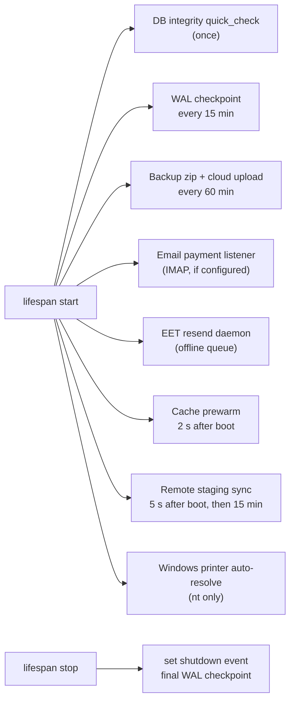

`services/hardware_profile.py` picks a hardware tier (RAM based) that sets the SQLite cache and mmap sizes and the number of months to prewarm.

### 4.4 Database lifecycle

- `database.py` resolves a freeze-safe path and opens SQLite in WAL mode; `atomic_transaction(db)` wraps multi-row writes.
- `migrations.py` runs `run_schema_migrations(engine)` on every start. It adds missing columns from the SQLAlchemy models, converts monetary columns to `Numeric`, and runs data migrations such as `migrate_pin_settings`.
- Backups: hourly zip (`backup_service`), optional cloud upload, optional continuous Litestream replication (`litestream.yml`).

---

## 5. Data model

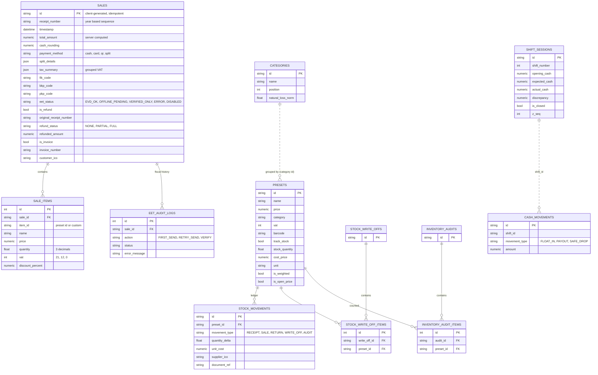

Standalone tables with no foreign keys:

| Table | Purpose |
| :-- | :-- |
| `store_config` | Single row: store profile, DIČ, EET certificate path and encrypted password, hardware settings, PIN and lock settings, inventory toggle |
| `receipt_sequences` | Per-year receipt counter |
| `invoice_sequences` | B2B invoice counter (`FA-YYYY-NNNN`) |
| `write_off_sequences`, `inventory_audit_sequences` | Protocol number counters |
| `deposit_movements` | Returnable-packaging (deposit) ledger |
| `applied_sync_events` | Idempotency keys for batches pulled from the cloud (`INTAKE`, `PRICE_CHANGE`, `PRODUCT`) |

Money is stored as `Numeric(10, 2)`. The backend recomputes totals and the VAT summary itself and never stores client-computed values (see 7.1).

---

## 6. Frontend (React 19)

### 6.1 Structure

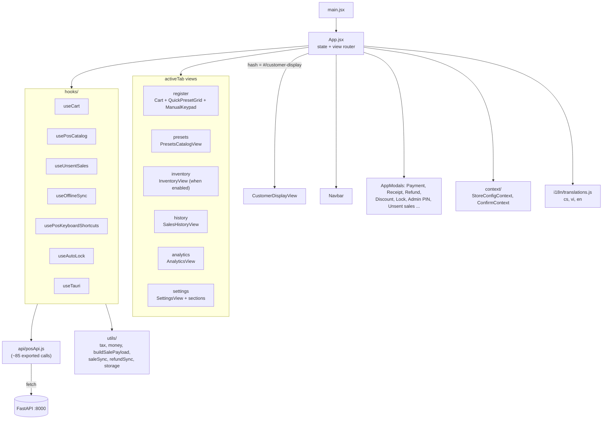

| Folder | Role |
| :-- | :-- |
| `src/App.jsx` | State container, tab router, customer-display mode switch (`#/customer-display`) |
| `src/api/posApi.js` | Single HTTP client; every backend call goes through it |
| `src/hooks/` | `useCart` (lines addressed by `lineId`, parked carts, undo toast), `usePosCatalog`, `useUnsentSales`, `useOfflineSync`, `usePosKeyboardShortcuts`, `useAutoLock`, `useTauri` |
| `src/components/` | Cart, keypad, payment panels, receipt, history, inventory, settings sections, modals |
| `src/utils/` | Money and VAT math (`tax.js`, `money.js`), sale payload (`buildSalePayload.js`), sync state (`saleSync.js`, `refundSync.js`), receipt HTML, barcode, storage wrapper |
| `src/context/` | `StoreConfigContext` (store config), `ConfirmContext` (confirm dialogs) |
| `src/i18n/` | cs, vi, en dictionary |
| `src/styles/`, `*.css` | Vanilla CSS with design tokens (no Tailwind) |

### 6.2 Client-side sale state

A sale made on the register is kept locally until the server accepts it. `saleSync.js` defines the state.

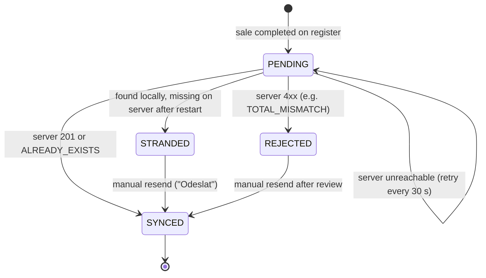

Only `SYNCED` sales can be refunded (`canRefund`). `PENDING`, `STRANDED`, `REJECTED` and EET-pending sales are never trimmed from local storage (`isLocalOnly`). The queue stays in `localStorage` because the backend is a local sidecar: "offline" means the process is down, and the server-side `ALREADY_EXISTS` check makes replays safe.

---

## 7. Key flows

### 7.1 Completing a sale

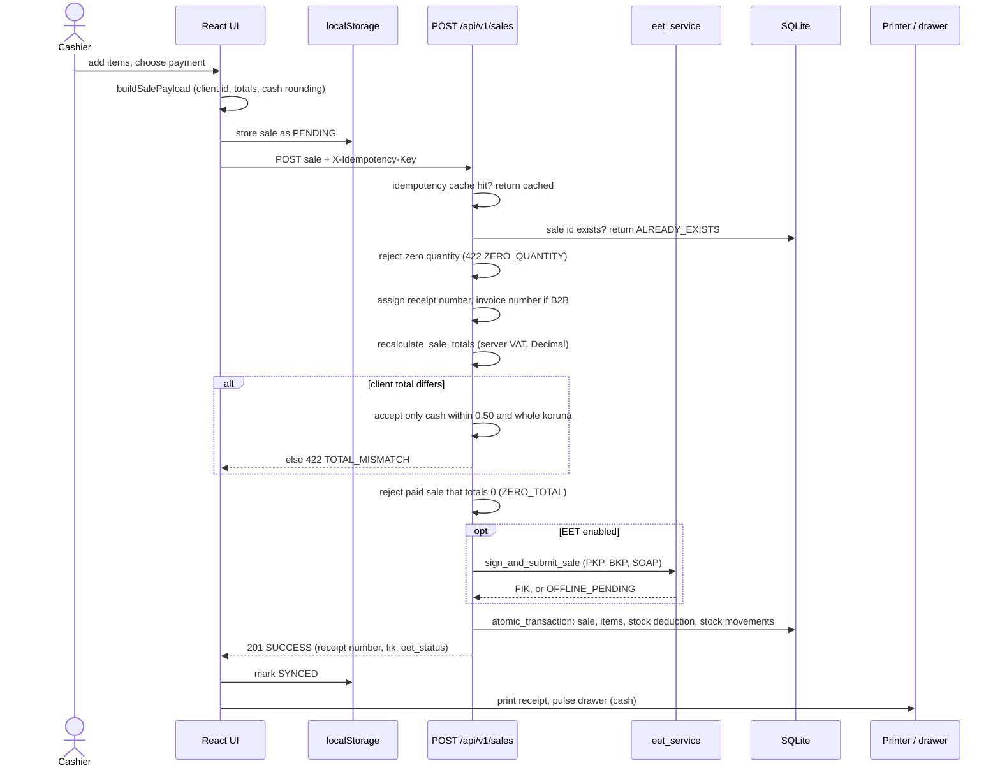

Server-side guarantees: totals and `tax_summary` always come from the server; the sale id is idempotent; stock changes and the sale row commit in one transaction.

### 7.2 Refund

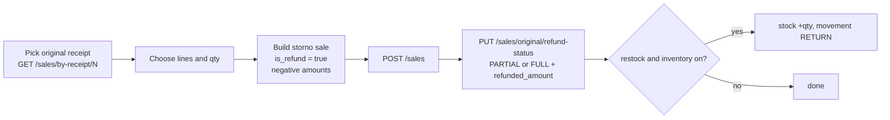

Cash refunds are rounded like cash sales (3.50 paid as 4 is refunded as 4, rounding noted). If the original-sale update fails, `refundSync.js` keeps the update owed and retries it.

### 7.3 EET fiscalization

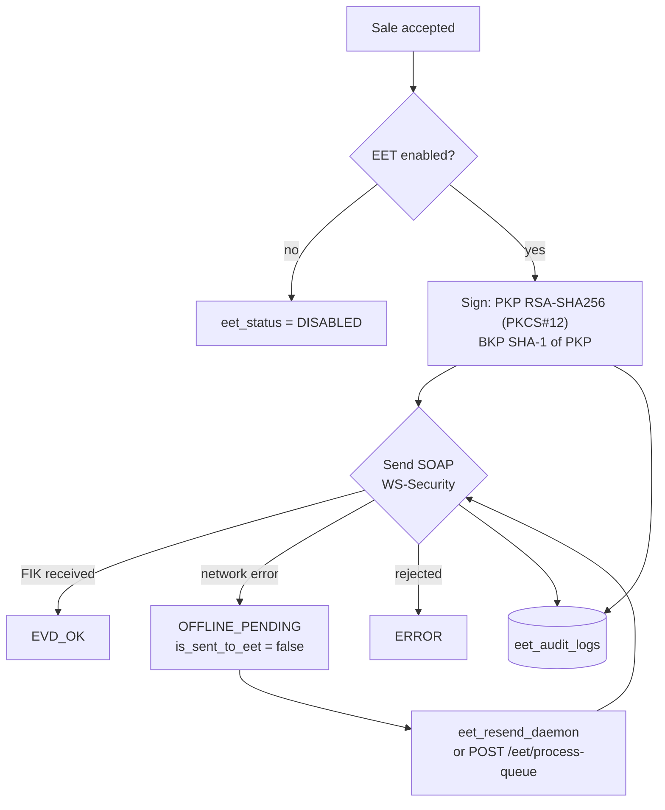

### 7.4 Payment methods

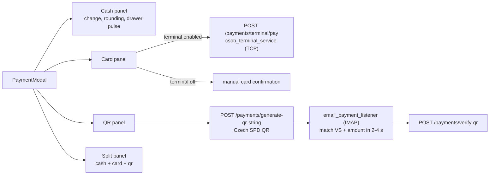

### 7.5 Customer display

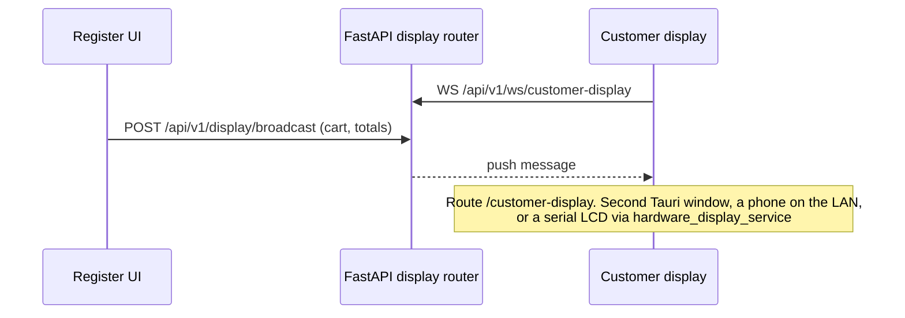

---

## 8. Integrations

| Integration | Code | Protocol |
| :-- | :-- | :-- |
| ESC/POS printer and RJ11 drawer | `services/escpos_service.py`, `printer_discovery.py`, `routers/printer.py` | USB, serial (9600 or 115200), TCP `:9100`, Windows spooler (`WIN32`) |
| ČSOB Ingenico Move 3500 | `services/csob_terminal_service.py`, `routers/payments.py` | TCP, default port 20002 |
| QR payment verification | `services/email_payment_listener.py`, `qr_bank_service.py` | SPD string, IMAP |
| EET 2.0 | `services/eet_crypto.py`, `eet_soap.py`, `eet_service.py`, `eet_resend_daemon.py` | SOAP, WS-Security 1.0, PKCS#12; playground and production |
| Customer LCD | `services/hardware_display_service.py`, `routers/display.py` | serial, WebSocket |
| Pohoda accounting | `services/pohoda_export.py` | XML export from `GET /sales/export/pohoda` |
| ARES company lookup | `routers/system.py` (`/ares/{ico}`) | HTTPS |
| Backups | `services/backup_service.py`, `cloud_sync_service.py`, `litestream.yml` | zip, S3 or R2, Litestream |

Reference material for these lives in `docs/eet_docs/`, `docs/csob_docs/` and `docs/guides/`.

---

## 9. Cloud and remote dashboard

Optional Phase 2 (see `docs/plans/REMOTE_WEB_DASHBOARD_PLAN.md`). The owner prepares products, price changes and supplier intakes remotely; the register pulls them.

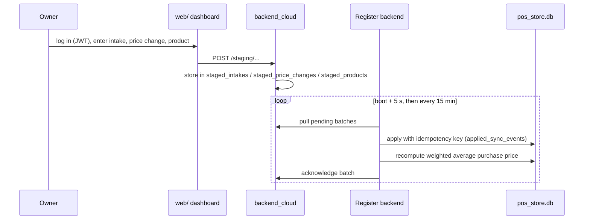

| Component | Content |
| :-- | :-- |
| `backend_cloud/` | Routers `auth`, `dashboard`, `analytics`, `staging`, `exports`, `catalog`; services `email_fetcher`, `isdoc_parser`, `ocr_service`; `snapshot_service.py`; Dockerfile and `docker-compose.yml` (port 8000, `./data` volume) |
| `web/` | Pages: Overview, Analytics, Catalog, Intake, Tax exports, Z-reports; `LoginModal`; `api/cloudApi.js` |

---

## 10. Security

- **PINs**: two independent, toggleable locks (lock screen and Admin PIN), off until the owner enables them. No built-in default PIN, PUK or master key. PINs are stored salted (scrypt); legacy hashes are upgraded on next successful entry. A recovery code is shown once. A master key works only if `POS_MASTER_ADMIN_KEY` (16+ characters) is set in the environment. See `docs/plans/BATCH_G_SECURITY_PLAN.md`. Enforcement is UI-side (audit item C1 stays open).
- **Rate limiting**: `services/rate_limiter.py` limits PIN attempts per client IP.
- **CORS**: allow-list from `ALLOWED_ORIGINS`, else localhost, `tauri.localhost` and private LAN ranges. Allowed headers include `X-Admin-PIN`, `X-Admin-Override`, `X-Idempotency-Key`.
- **Path traversal**: the SPA fallback checks that every served path stays inside `dist/`.
- **Secrets**: the EET certificate password is stored encrypted in `store_config` and decrypted on use.
- **Financial integrity**: server-side VAT recalculation, idempotent sale ids, atomic transactions.
- **Audits**: `docs/audit/` (findings, fix recommendations, flow maps) and `docs/guides/SECURITY_AUDIT.md`.

---

## 11. Build, packaging and CI

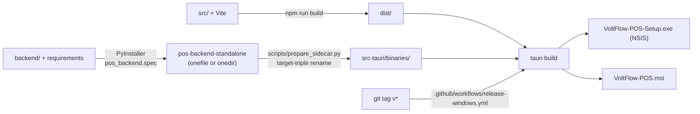

Build scripts live in `scripts/build/` (`build_standalone.*`, `build_windows_release.bat`). Auxiliary tools (kiosk, service install with NSSM, stop, hardware preflight, customer display) are in `scripts/tools/`.

---

## 12. Quality gates

| Gate | Command |
| :-- | :-- |
| Frontend tests (Vitest) | `npm run test` |
| Frontend lint (Oxlint) | `npm run lint` |
| Production build | `npm run build` |
| Backend tests (unittest) | `python -m unittest discover -s backend/tests -p "test_*.py"` |
| Cloud backend tests | `backend_cloud/tests/` |

Sale payload parity between client and server is covered by contract fixtures (`backend/tests/fixtures/sales/`, `test_sale_contract`).
